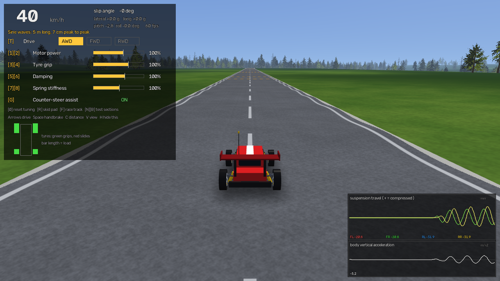
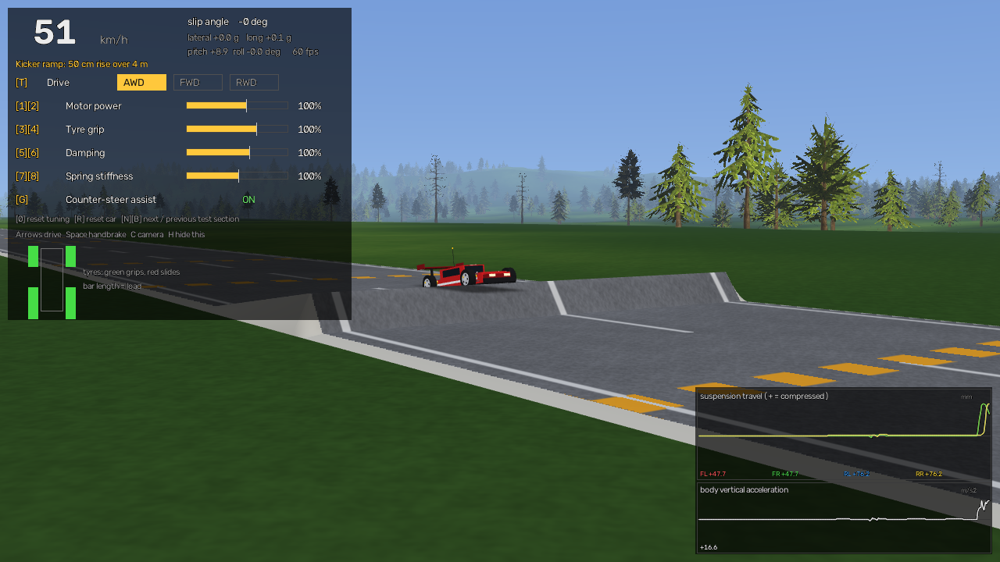
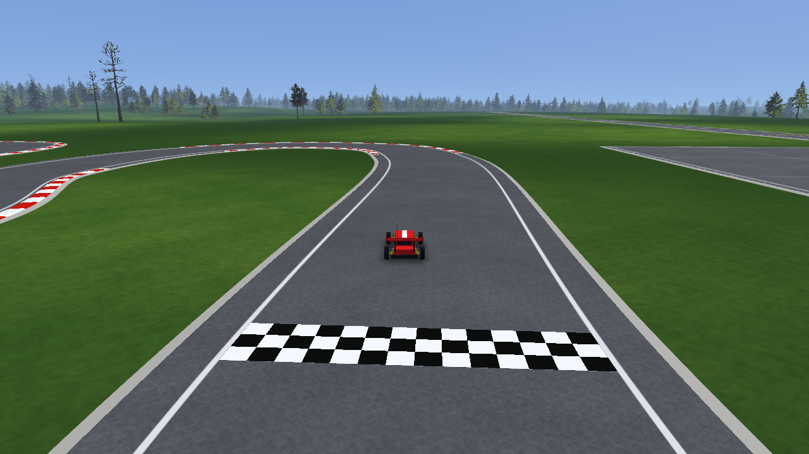
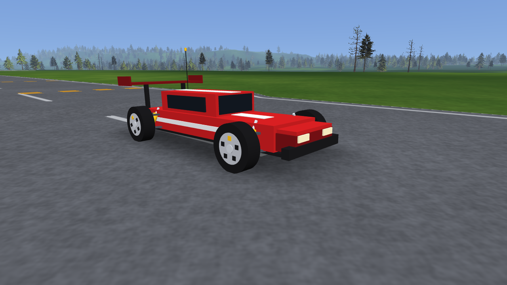
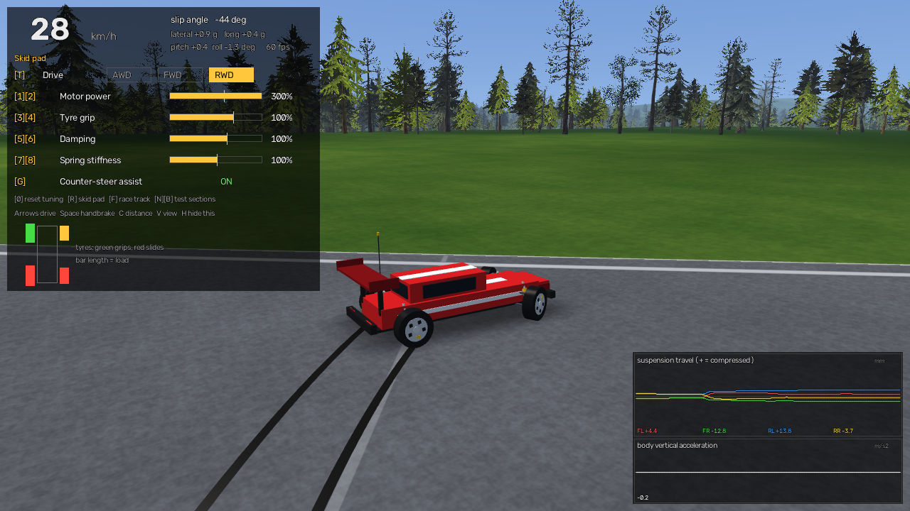

# outdoor-sim

A grass proving ground with a half-scale RC buggy to drive round it. It is for playing with suspension, tyre grip and drivetrain settings.

```bash
python outdoor-sim/drive.py
```



## The environment

- **Terrain**: virtual-sim's grass hills and trees, flattened around the paving.
- **Skid pad**: an 80 × 60 m paved area with a 20 m circle, where the car starts.
- **Test road**: 8 m wide and running 340 m east from the pad. It has these sections, in order:
  - sine waves: 5 m long, 7 cm peak to peak
  - washboard: 0.9 m long, 3 cm
  - speed humps: 7 cm high, every 10 m
  - frequency sweep: 7 m waves shrinking to 0.8 m
  - potholes: 4 cm deep
  - kicker ramp: 50 cm rise
- **RC race track**: a 335 m loop on the grass north of the pad. It is 6 m of asphalt with 2.5 cm red-and-white kerbs in the corners and a chequered start line. Press F to go to the start; the panel shows your lap times.





## The car

A 1/2-scale buggy: 152 kg, 1.3 m wheelbase, 0.84 m track. The physics runs at 600 Hz.

- **Suspension**: each wheel hangs on two parallel arms, so it stays upright as it moves through 14 cm of travel. Each corner has its own spring and damper, with bump stops and an anti-roll bar on each axle.
- **Wheel contact**: each tyre tests 51 points around its rim against the ground, so it hits the leading edge of a bump before the bump is under the hub.
- **Tyres**: grip peaks and then falls off as a tyre slides. Grass has 60 % of the grip of asphalt. Sliding tyres leave skid marks.
- **Drivetrain**: AWD, FWD or RWD, with ABS brakes, a rear handbrake and Ackermann steering.
- **Counter-steer assist** (on by default): steers the front wheels towards where the front axle is moving and eases the throttle in big slides, so drifts are held instead of ending in a spin.





## Keys

| Key | Action |
| --- | --- |
| Arrows | throttle, brake / reverse, steer |
| Space | handbrake |
| T | drivetrain: AWD / FWD / RWD |
| G | counter-steer assist on / off |
| 1 / 2 | motor power down / up |
| 3 / 4 | tyre grip down / up |
| 5 / 6 | damping down / up |
| 7 / 8 | springs softer / stiffer |
| 0 | reset the tuning |
| R | back to the skid pad |
| F | to the race track's start line |
| N / B | next / previous test section, at a running start |
| C | chase camera distance: close / normal / far / high |
| V | camera view: chase / bumper / suspension close-up / trackside |
| Mouse drag / wheel | orbit / zoom the chase camera |
| H | panel on / off |

The panel at the top left shows every tuning value and a top view of the tyres (green: gripping, red: sliding). The charts at the bottom right show suspension travel and body acceleration.

## Files

- `drive.py` is the app. `--screenshot` renders one frame of a scripted run without a window; see `--help`.
- `ground.py` builds the terrain, paving and bumps.
- `track.py` builds the race track and the lap timer.
- `view.py` draws everything.
- `panel.py` draws the panel and charts.
- `car/` holds the car's parameters, physics and 3D model.
- `tests/` has the tests: `python -m pytest outdoor-sim/tests`.
